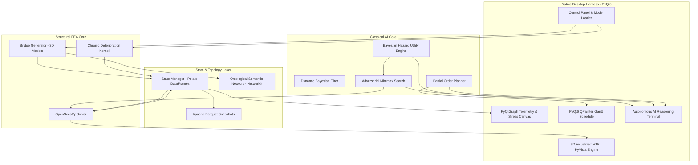

# Physics-Informed Autonomous FEA Stress Injection & POP Maintenance Harness

> **An End-to-End Computational Architecture for Non-Linear Finite Element Structural Health Assessment, Adversarial Stress Injection, and Dependency-Aware Predictive Maintenance Planning**

---

## 📖 Executive Summary

Civil infrastructure longevity assessment under compounding chronic environmental stressors and acute extreme load anomalies presents a multi-scale, non-linear optimization challenge. Traditional structural health monitoring (SHM) systems rely on uncoupled finite element analysis (FEA) or post-hoc heuristics that fail to simulate adversarial structural vulnerabilities dynamically.

This project delivers a **physics-informed, desktop-native classical AI framework** that integrates:
1. **OpenSeesPy Mechanics Engine** for 3D non-linear continuum and frame element structural analysis.
2. **Polars & Apache Parquet Columnar Engine** for microsecond-latency tensor analytics and compressed state log checkpointing.
3. **Ontological Semantic Network** with Frame-and-Slot limit state definitions for structural topology management.
4. **Dynamic Bayesian Hidden Markov Inferencing** for tracking chronic environmental degradation (chloride penetration, elastic modulus decay).
5. **Bayesian Hazard & Destructive Utility Engine** for determining optimal failure injection targets given weather/disaster hyperparameter context.
6. **Adversarial Minimax Search with Physics-Informed $\alpha$-$\beta$ Pruning** for evaluating multi-step cascading structural collapses.
7. **State-Space Partial Order Planning (POP)** for synthesizing dependency-aware retrofit schedules with causal link protection.
8. **Native PyQt6 / PyVista VTK Desktop GUI** for real-time 3D deformation rendering, telemetry visualization, and Gantt chart scheduling.

---

## 🏗️ System Architecture & Dataflow



---

## 🧮 Mathematical Formulations & Algorithms

### 1. Topological Knowledge Representation (Ontological Semantic Networks)
Structural topology is represented as a directed multigraph $G = (V, E)$, where $V$ represents 6-DOF boundary/connection nodes and $E$ represents frame section elements. Each structural element is stored within a Frame-and-Slot schema:

$$\text{Frame}(e_k) = \begin{pmatrix} \text{Slot: Node}_{\text{start}} & n_i \\ \text{Slot: Node}_{\text{end}} & n_j \\ \text{Slot: Material Model} & \text{Steel / Concrete} \\ \text{Slot: Section Capacity} & [A, I_{yy}, I_{zz}, J] \\ \text{Slot: Yield Stress } f_y & \sigma_{\text{yield}}(t) \\ \text{Slot: Damage } D & \int \dot{\varepsilon}_p \, dt \end{pmatrix}$$

### 2. Chronic Deterioration (Probabilistic Temporal Inference)
Ambient sensor observations $\mathbf{E}_t$ update structural latent states $\mathbf{X}_t$ via a Dynamic Bayesian Network:

$$P(\mathbf{X}_t \mid \mathbf{e}_{1:t}) = \alpha \cdot P(\mathbf{e}_t \mid \mathbf{X}_t) \int_{\mathbf{X}_{t-1}} P(\mathbf{X}_t \mid \mathbf{X}_{t-1}) P(\mathbf{X}_{t-1} \mid \mathbf{e}_{1:t-1}) \, d\mathbf{X}_{t-1}$$

- **Chloride Corrosion Cross-Sectional Loss:**
  $$A_k(t) = A_k(0) - \kappa \cdot (t - t_{\text{initiation}})^{\gamma}$$
- **Exponential Modulus Decay:**
  $$E_k(t) = E_k(0) \cdot \exp(-\lambda_{\text{env}} \cdot t)$$

### 3. Bayesian Hazard Injection & Multi-Factor Destructive Utility $U(n)$
Given environmental hyperparameter vector $\boldsymbol{\theta} = \{\text{WindSpeed}, \text{ScourDepth}, \text{ThermalGradient}, \text{SeismicPGA}\}$, the posterior probability of hazard $E_i$ is computed as:

$$P(E_i \mid \boldsymbol{\theta}) = \frac{P(\boldsymbol{\theta} \mid E_i) \cdot P(E_i)}{\sum_{j} P(\boldsymbol{\theta} \mid E_j) \cdot P(E_j)}$$

Target selection maximizes the destructive utility objective function:

$$U(n) = \left[ \sum_{i=1}^k P(E_i \mid \boldsymbol{\theta}) \cdot \|\mathbf{I}(E_i, n)\|_2 \right] - \omega \cdot S(n, t)$$

where $S(n, t) = \min_{e \in \text{Adj}(n)} \left( \frac{\sigma_{\text{allowable}}(t) - \sigma_{\text{vonMises}}(e, t)}{\sigma_{\text{allowable}}(t)} \right)$ is the normalized remaining tensile capacity margin.

### 4. Adversarial Minimax Search with $\alpha$-$\beta$ Pruning
The agent models failure propagation as a zero-sum game:
- **Attacker ($\text{MAX}$):** Maximizes global strain energy and plastic displacements.
- **Structural Defense ($\text{MIN}$):** Minimizes compliance by redistributing load through tangent stiffness matrix equilibrium ($K_{\text{tangent}} \Delta u = P_{\text{ext}} - F_{\text{int}}$).

Physics-informed pruning truncates search branches when adjacent redistributed element stresses satisfy $\max(\sigma_{e_{\text{adj}}}) < 0.35 f_y$.

### 5. Partial Order Planning (POP) Retrofit Schedule
Formulated as a state-space tuple $\Pi = \langle \mathcal{S}, \mathcal{A}, \mathcal{I}, \mathcal{G} \rangle$. POP resolves open conditions while protecting causal safety links ($S_i \xrightarrow{p} S_j$). Threat conflicts are resolved by enforcing ordering constraints $(S_k \prec S_i) \lor (S_j \prec S_k)$.

---

## 📂 Repository Structure

```
.
├── ai/                         # Classical AI & Decision Intelligence Engine
│   ├── adversarial_minimax.py  # Minimax game-tree search w/ physics-informed alpha-beta pruning
│   ├── dynamic_bayesian.py     # Dynamic Bayesian Network / Hidden Markov Model for state filtering
│   ├── hazard_utility_engine.py# Bayesian hazard posteriors P(E_i|theta) & ArgMax U(n) utility
│   └── partial_order_planner.py# Dependency-aware Partial Order Planning (POP) engine
├── core/                       # Core Schemas, Topology & State Management
│   ├── schema.py               # Pydantic data models (Node3D, ElementFrame, HazardContext, etc.)
│   ├── semantic_network.py     # NetworkX Frame-and-Slot Ontological Semantic Multigraph
│   └── state_manager.py        # Active state memory & Apache Parquet telemetry checkpointing
├── physics/                    # Continuum Mechanics & Finite Element Analysis
│   ├── bridge_models.py        # 3D Bridge loaders (Monash 28m Super-T, 33.5m Super-T, Steel Warren Truss)
│   ├── degradation_models.py   # Chloride corrosion & exponential elastic modulus decay kernels
│   └── opensees_wrapper.py     # OpenSeesPy FEA computational mechanics wrapper (3D 6-DOF)
├── gui/                        # PyQt6 Desktop Application & Renderers
│   ├── dashboard_widget.py     # Real-time PyQtGraph telemetry canvas for stress & modulus curves
│   ├── gantt_widget.py         # Custom PyQt6 QPainter Gantt chart widget for POP schedules
│   ├── vtk_viewer.py           # Hardware-accelerated 3D OpenGL VTK/PyVista structural visualizer
│   └── main_window.py          # Native desktop main application window & AI reasoning terminal
├── tests/                      # Automated Unit Test Suite (10 unit tests)
│   ├── test_bayesian_utility.py
│   ├── test_bridge_models.py
│   ├── test_minimax.py
│   ├── test_opensees_wrapper.py
│   ├── test_pop_planner.py
│   └── test_state_manager.py
├── github_models/              # Peer-reviewed open-source bridge repository dependencies
│   └── ospgrillage/            # OpenSeesPy Grillage bridge modeling library
├── main.py                     # Desktop Application Entry Point
├── mat_lib.json                # Structural Material & Section Capacity Library
├── requirements.txt            # Python Dependencies & PIN Constraints (NumPy < 2.0)
└── research_implementation_plan.md # Academic research paper & algorithmic documentation
```

---

## 🛠️ Module Reference & API Specification

### [`core/schema.py`](file:///c:/Users/Dheeraj%20Sutram/Documents/projects/AI/New%20folder/AI%20project/core/schema.py)
Defines core data structures using Pydantic:
- [`Node3D`](file:///c:/Users/Dheeraj%20Sutram/Documents/projects/AI/New%20folder/AI%20project/core/schema.py#L4-L13): Represents a 3D structural node with 6 Degrees of Freedom (`ux`, `uy`, `uz`, `rx`, `ry`, `rz`).
- [`ElementFrame`](file:///c:/Users/Dheeraj%20Sutram/Documents/projects/AI/New%20folder/AI%20project/core/schema.py#L15-L30): Represents elastic/non-linear 3D beam-column section elements.
- [`HazardContext`](file:///c:/Users/Dheeraj%20Sutram/Documents/projects/AI/New%20folder/AI%20project/core/schema.py#L31-L37): Stores weather & disaster parameters (`wind_speed`, `scour_depth`, `seismic_pga`).
- [`AttackVector`](file:///c:/Users/Dheeraj%20Sutram/Documents/projects/AI/New%20folder/AI%20project/core/schema.py#L38-L44): Captures acute failure injection target node, hazard type, and 6-DOF impulse payload.
- [`PlanAction`](file:///c:/Users/Dheeraj%20Sutram/Documents/projects/AI/New%20folder/AI%20project/core/schema.py#L45-L54): POP repair operator definition (`preconditions`, `effects`, `duration_days`, `cost`).
- [`PartialOrderPlan`](file:///c:/Users/Dheeraj%20Sutram/Documents/projects/AI/New%20folder/AI%20project/core/schema.py#L55-L60): Resulting partial order plan DAG with causal links and ordering constraints.

### [`core/state_manager.py`](file:///c:/Users/Dheeraj%20Sutram/Documents/projects/AI/New%20folder/AI%20project/core/state_manager.py)
- [`StateManager`](file:///c:/Users/Dheeraj%20Sutram/Documents/projects/AI/New%20folder/AI%20project/core/state_manager.py#L6-L95): Maintains active simulation tables in Polars DataFrames (`df_nodes`, `df_elements`, `df_telemetry`), computes tensile capacity margins $S(n, t)$, and flushes Snappy-compressed Apache Parquet snapshots (`state_checkpoint_step_XXXXXX.parquet`).

### [`core/semantic_network.py`](file:///c:/Users/Dheeraj%20Sutram/Documents/projects/AI/New%20folder/AI%20project/core/semantic_network.py)
- [`OntologicalSemanticNet`](file:///c:/Users/Dheeraj%20Sutram/Documents/projects/AI/New%20folder/AI%20project/core/semantic_network.py#L5-L59): Maps physical FEA topology into a NetworkX Frame-and-Slot multigraph, supporting dynamic slot updates and redundant kinematic path extraction.

### [`physics/opensees_wrapper.py`](file:///c:/Users/Dheeraj%20Sutram/Documents/projects/AI/New%20folder/AI%20project/physics/opensees_wrapper.py)
- [`OpenSeesFEASolver`](file:///c:/Users/Dheeraj%20Sutram/Documents/projects/AI/New%20folder/AI%20project/physics/opensees_wrapper.py#L6-L114): OpenSeesPy FEA computational mechanics wrapper. Builds 3D 6-DOF models, applies 6-DOF kinetic point forces/moments, executes non-linear static equilibrium steps (`Newton` solver with `RCM` renumbering), and queries nodal displacements and element von Mises stresses.

### [`physics/bridge_models.py`](file:///c:/Users/Dheeraj%20Sutram/Documents/projects/AI/New%20folder/AI%20project/physics/bridge_models.py)
- [`BridgeGenerator`](file:///c:/Users/Dheeraj%20Sutram/Documents/projects/AI/New%20folder/AI%20project/physics/bridge_models.py#L6-L274): Generates high-fidelity 3D structural models:
  - 48m Industrial Steel Warren Through-Truss Bridge with Substructure Piers (`generate_industrial_truss_bridge`).

### [`physics/degradation_models.py`](file:///c:/Users/Dheeraj%20Sutram/Documents/projects/AI/New%20folder/AI%20project/physics/degradation_models.py)
- Vectorized degradation kernels:
  - [`compute_chloride_corrosion_area`](file:///c:/Users/Dheeraj%20Sutram/Documents/projects/AI/New%20folder/AI%20project/physics/degradation_models.py#L4-L9): Fickian chloride cross-sectional area loss.
  - [`compute_modulus_decay`](file:///c:/Users/Dheeraj%20Sutram/Documents/projects/AI/New%20folder/AI%20project/physics/degradation_models.py#L11-L13): Exponential elastic modulus decay $E(t) = E_0 e^{-\lambda t}$.
  - [`apply_chronic_degradation`](file:///c:/Users/Dheeraj%20Sutram/Documents/projects/AI/New%20folder/AI%20project/physics/degradation_models.py#L15-L20): Single-kernel vectorized degradation execution over Polars DataFrames.

### [`ai/dynamic_bayesian.py`](file:///c:/Users/Dheeraj%20Sutram/Documents/projects/AI/New%20folder/AI%20project/ai/dynamic_bayesian.py)
- [`DynamicBayesianInference`](file:///c:/Users/Dheeraj%20Sutram/Documents/projects/AI/New%20folder/AI%20project/ai/dynamic_bayesian.py#L3-L34): Forward Bayesian filter over latent structural states (`Intact`, `Corroded/Cracked`, `Plastic Yield`).

### [`ai/hazard_utility_engine.py`](file:///c:/Users/Dheeraj%20Sutram/Documents/projects/AI/New%20folder/AI%20project/ai/hazard_utility_engine.py)
- [`BayesianHazardUtilityEngine`](file:///c:/Users/Dheeraj%20Sutram/Documents/projects/AI/New%20folder/AI%20project/ai/hazard_utility_engine.py#L8-L80): Computes Bayesian posterior hazard probabilities $P(E_i | \boldsymbol{\theta})$ and evaluates expected destructive utility $U(n)$ across structural nodes to select optimal attack target vectors.

### [`ai/adversarial_minimax.py`](file:///c:/Users/Dheeraj%20Sutram/Documents/projects/AI/New%20folder/AI%20project/ai/adversarial_minimax.py)
- [`AdversarialMinimaxEngine`](file:///c:/Users/Dheeraj%20Sutram/Documents/projects/AI/New%20folder/AI%20project/ai/adversarial_minimax.py#L5-L59): Game-tree search engine evaluating cascading failure sequences using Minimax search with $\alpha$-$\beta$ pruning.

### [`ai/partial_order_planner.py`](file:///c:/Users/Dheeraj%20Sutram/Documents/projects/AI/New%20folder/AI%20project/ai/partial_order_planner.py)
- [`PartialOrderPlanner`](file:///c:/Users/Dheeraj%20Sutram/Documents/projects/AI/New%20folder/AI%20project/ai/partial_order_planner.py#L5-L61): Dependency-aware Partial Order Planning (POP) solver that backchains from goal state to resolve open conditions and enforce ordering constraints.

### `gui/` Desktop Visualizers
- [`VTKStructureViewer`](file:///c:/Users/Dheeraj%20Sutram/Documents/projects/AI/New%20folder/AI%20project/gui/vtk_viewer.py#L11-L118): Embedded PyVista QtInteractor renderer for 3D structural wireframes, tubular beam members, and stress heatmaps.
- [`TelemetryDashboardWidget`](file:///c:/Users/Dheeraj%20Sutram/Documents/projects/AI/New%20folder/AI%20project/gui/dashboard_widget.py#L4-L31): PyQtGraph canvas rendering live modulus decay curves and peak stress telemetry.
- [`GanttChartWidget`](file:///c:/Users/Dheeraj%20Sutram/Documents/projects/AI/New%20folder/AI%20project/gui/gantt_widget.py#L6-L78): Custom PyQt6 QPainter Gantt chart displaying phase durations, budget summaries, and dependency ordering.
- [`MainWindow`](file:///c:/Users/Dheeraj%20Sutram/Documents/projects/AI/New%20folder/AI%20project/gui/main_window.py#L20-L232): Central desktop control harness orchestrating bridge selection, FEA execution, stress injection, POP synthesis, and live AI terminal logging.

---

## 🚀 Installation & Setup

### System Prerequisites
- **Operating System:** Windows 10/11, Linux, or macOS.
- **Python Version:** Python 3.10 to 3.12.
- **Important:** NumPy must be pinned to **`< 2.0.0`** due to C-ABI compatibility requirements with OpenSeesPy.

### 1. Clone & Set Up Virtual Environment

```bash
# Navigate to workspace directory
cd "c:\Users\Dheeraj Sutram\Documents\projects\AI\New folder\AI project"

# Create a virtual environment
python -m venv .venv

# Activate the virtual environment (Windows PowerShell)
.venv\Scripts\Activate.ps1
```

### 2. Install Dependencies

```bash
pip install -r requirements.txt
```

---

## 💻 Running the Application

### 1. Launch the Desktop GUI Application

```bash
python main.py
```

#### Desktop GUI Control Guide:
1. **Bridge Selection Dropdown:** 48m Steel Warren Through-Truss Bridge with Substructure Piers.
2. **Run FEA Baseline Step:** Applies operational deck traffic loads and updates 3D deformation visualizer and stress curves.
3. **Execute Adversarial Attack:** Triggers the Bayesian Hazard Utility Engine to select vulnerable structural target nodes and inject acute failure loads.
4. **Synthesize POP Retrofit Plan:** Computes dependency-aware repair sequences and renders the maintenance schedule in the Gantt chart tab.
5. **🤖 AI Agent Reasoning Terminal:** Live logging of Bayesian posterior calculations, tensile capacity margin evaluations, and plan synthesis steps.

---

## 🧪 Testing & Verification

The harness includes a complete suite of automated unit tests covering physics solvers, state management, AI search, hazard utility, and plan synthesis.

To run the test suite:

```bash
.venv\Scripts\python.exe -m pytest tests/ -v
```

### Test Suite Summary (`10 Passed`):
- `test_hazard_posteriors_and_utility`: Verifies Bayesian posterior hazard calculation and utility node targeting.
- `test_generate_industrial_truss_bridge`: Validates 3D steel truss and concrete pier mesh creation.
- `test_github_28m_supert_bridge_loader`: Validates Monash 28m Super-T bridge domain extraction.
- `test_github_33m_supert_bridge_loader`: Validates 33.5m Super-T bridge domain extraction.
- `test_minimax_search`: Verifies Minimax alpha-beta pruning search tree evaluation.
- `test_opensees_build_and_solve`: Validates static equilibrium solution in OpenSeesPy.
- `test_apply_load_after_ospgrillage_model`: Ensures clean load application on loaded bridge models.
- `test_partial_order_planning`: Verifies causal link resolution and plan ordering in POP solver.
- `test_parquet_checkpointing`: Tests state flushing to Snappy-compressed Apache Parquet format.
- `test_state_manager_initialization`: Verifies initial Polars schema creation for nodes and elements.

---

## 📜 License & Citation

This project is developed under the academic implementation plan outlined in [`research_implementation_plan.md`](file:///c:/Users/Dheeraj%20Sutram/Documents/projects/AI/New%20folder/AI%20project/research_implementation_plan.md). If you use this software in research or academic work, please cite:

> *A Physics-Informed Autonomous Adversarial Agent Architecture for Non-Linear Structural Degradation Simulation and Optimal Predictive Maintenance Planning*, 2026.
