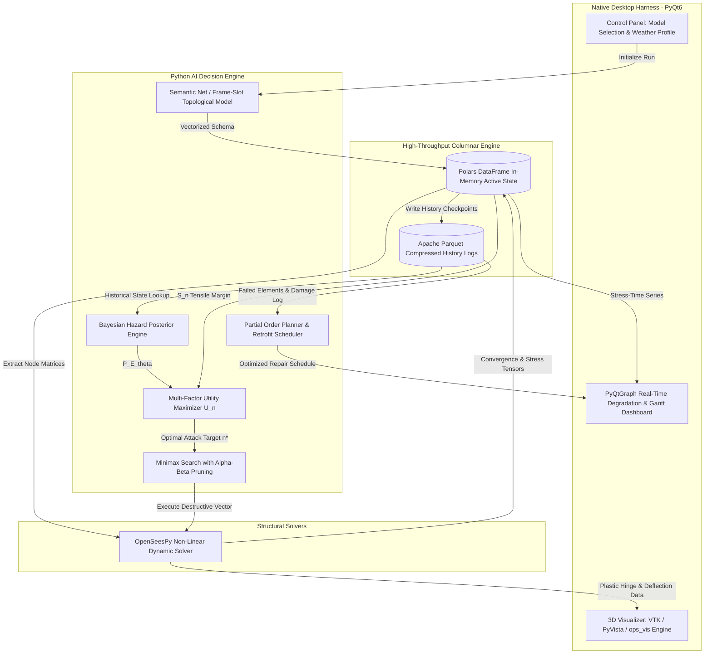

# Autonomous Finite Element Stress Injection and Optimal Predictive Maintenance Scheduling: A Physics-Informed Classical AI Architecture

## Project Title
**A Physics-Informed Autonomous Adversarial Agent Architecture for Non-Linear Structural Degradation Simulation and Optimal Predictive Maintenance Planning**

---

## Abstract

Civil infrastructure integrity assessment under compounding chronic environmental stressors and acute extreme load anomalies presents a multi-scale, coupled non-linear optimization challenge. Traditional structural health monitoring (SHM) workflows depend either on decoupled finite element analysis (FEA) or post-hoc heuristics that fail to simulate adversarial structural vulnerabilities dynamically. 

This paper proposes an end-to-end, high-performance native desktop computational architecture driven by an autonomous artificial intelligence agent. The environment integrates **OpenSeesPy** for non-linear finite element continuum mechanics and dynamic load redistribution, backed by **Polars** and columnar **Apache Parquet** telemetry for microsecond-latency tensor analytics. Structural topology is formally mapped to an **Ontological Semantic Network** with Frame-and-Slot limit state definitions. Chronic environmental degradation (e.g., chloride-induced corrosion, cyclic fatigue) is modeled via **Probabilistic Temporal Inference over Dynamic Bayesian Models**. Acute catastrophe vectors are injected using **Bayesian Networks** that resolve posterior structural failure probabilities, prioritized across topological nodes via an integrated **Multi-Factor Destructive Utility Engine $U(n)$**. Post-failure cascade evaluation is computed via **Adversarial Minimax Search with $\alpha$-$\beta$ Pruning**, treating the degradation agent as a destructive adversary and the structural stiffness matrix as a resilient responder. Finally, optimal maintenance and retrofit sequences are synthesized using **State-Space Partial Order Planning (POP)** under causal link protection and resource constraints. The entire harness operates natively within a compiled **PyQt6/PyQtGraph/VTK** desktop pipeline, bypassing web-layer overhead and enabling real-time 3D deformation and degradation analytics.

---

## Software and Modules Used

| Subsystem / Layer | Software / Module | Technical Specification & Academic Justification |
| :--- | :--- | :--- |
| **Physics Simulation Engine** | `OpenSeesPy` | High-fidelity, open-source finite element analysis (FEA) framework for non-linear inelastic structural response, dynamic multi-degree-of-freedom (MDOF) time-history analysis, and fiber section stress-strain formulations without cross-compilation overhead. |
| **Columnar Data Engine & State Logging** | `Polars` (Rust core) & `Apache Parquet` | SIMD-accelerated, multi-threaded columnar memory execution for high-throughput node-displacement matrices, stress tensors, and historical simulation rollbacks. Parquet provides snappy compression and zero-copy slicing for microsecond state lookups. |
| **Desktop Application Harness** | `PyQt6` | Compiled C++ Qt6 wrapper offering native event-loop orchestration, deterministic memory management, multi-threaded worker signals (`QThread`), and OS-level platform responsiveness without browser engine abstraction. |
| **Native 3D Continuum Visualization** | `ops_vis` / `opstool` (`VTK` / `PyVista` backend) | Hardware-accelerated OpenGL/VTK pipeline for rendering 3D beam-column geometries, wireframes, mode shapes, dynamic deflected plastic hinge zones, and color-mapped Cauchy stress fields. |
| **Real-Time Analytics & Telemetry** | `PyQtGraph` / `Matplotlib Qt` | Low-overhead 60 FPS plotting canvas embedded in the native harness to render instantaneous degradation curves, spectral density shifts, stiffness matrix degradation, and Gantt-scheduled maintenance vectors. |
| **Classical AI & Optimization Core** | `NumPy`, `SciPy`, `NetworkX`, custom agent core | Vectorized linear algebra, exact Bayesian inference engine, adversarial game-tree evaluator, and Partial Order Planning graph solver. |

---

## Algorithms Used and Mathematical Formulations

```
+--------------------------------------------------------------------------------------------------+
|                                    AUTONOMOUS AGENT CORE PIPELINE                                |
+--------------------------------------------------------------------------------------------------+
|                                                                                                  |
|   +------------------------------------------------------------------------------------------+   |
|   | 1. ONTOLOGICAL SEMANTIC NET (Polars Dataframes)                                          |   |
|   |    Nodes: E_i = (X, Y, Z, BC)  |  Edges: B_j = (N_start, N_end, CrossSection, E, I_y, I_z)  |   |
|   |    Frames & Slots: Yield Limit f_y, Plastic Hinge Capacity M_p, Elastic Modulus E(t)     |   |
|   +------------------------------------------------------------------------------------------+   |
|                                             |                                                    |
|                                             v                                                    |
|   +------------------------------------------------------------------------------------------+   |
|   | 2. CHRONIC DEGRADATION (Temporal Probabilistic Inference)                                |   |
|   |    P(X_t | e_{1:t}) \propto P(e_t | X_t) \int P(X_t | X_{t-1}) P(X_{t-1} | e_{1:t-1}) dX_{t-1}  |   |
|   |    E(t) = E_0 \cdot \exp(-\alpha t), \quad A_{eff}(t) = A_0 - \beta \sqrt{t}             |   |
|   +------------------------------------------------------------------------------------------+   |
|                                             |                                                    |
|                                             v                                                    |
|   +------------------------------------------------------------------------------------------+   |
|   | 3. MULTI-FACTOR DECISION ENGINE & BAYESIAN DISASTER INJECTION                            |   |
|   |    U(n) = \sum [ P(E_i | \theta) \cdot I(E_i) ] - \omega \cdot S(n)                     |   |
|   |    ArgMax_n U(n) -> Injects Extreme Load / Boundary Rupture into OpenSeesPy Model        |   |
|   +------------------------------------------------------------------------------------------+   |
|                                             |                                                    |
|                                             v                                                    |
|   +------------------------------------------------------------------------------------------+   |
|   | 4. LOAD RE-BALANCING & ADVERSARIAL GAME SEARCH (Minimax with \alpha-\beta Pruning)       |   |
|   |    v = \max(v, \text{MinValue}(Child, \alpha, \beta))  |  Prune if \alpha \ge \beta       |   |
|   |    Physics-informed pruning of non-critical branch topologies                            |   |
|   +------------------------------------------------------------------------------------------+   |
|                                             |                                                    |
|                                             v                                                    |
|   +------------------------------------------------------------------------------------------+   |
|   | 5. PREDICTIVE RETROFIT ORCHESTRATION (Partial Order Planning / POP)                      |   |
|   |    Plan = <Actions, Causal Links S_i --[p]--> S_j, Ordering Constraints S_i < S_k>       |   |
|   |    Resolves Threats / Causal Conflicts -> Synthesizes Maintenance Timeline & Gantt Chart|   |
|   +------------------------------------------------------------------------------------------+   |
|                                                                                                  |
+--------------------------------------------------------------------------------------------------+
```

---

### 1. Topological Knowledge Representation: Ontological Semantic Networks & Frame Systems
* **Target Objective:** Establish an unambiguous, queryable topological and structural taxonomy of the continuous structural system in memory.
* **Formalization:**
  * **Ontological Entities:** The physical structure is defined as a directed multigraph $G = (V, E)$, where vertices $V = \{n_1, n_2, \dots, n_m\}$ denote physical boundary/connection nodes with 6 Degrees of Freedom (DOFs: translations $u_x, u_y, u_z$ and rotations $\theta_x, \theta_y, \theta_z$), and edges $E = \{e_1, e_2, \dots, e_k\}$ denote non-linear frame/truss elements.
  * **Frames and Slots Schema:** Each structural element is instantiated with a slot-value matrix within a Polars schema:
    $$\text{Frame}(e_k) = \begin{pmatrix} \text{Slot: Node}_{\text{start}} & n_i \\ \text{Slot: Node}_{\text{end}} & n_j \\ \text{Slot: Material Model} & \text{Steel01 / Concrete02} \\ \text{Slot: Section Capacity} & [A, I_{yy}, I_{zz}, J] \\ \text{Slot: Yield Stress } f_y & \sigma_{\text{yield}}(t) \\ \text{Slot: Cumulative Plastic Damage } D & \int \dot{\varepsilon}_p \, dt \end{pmatrix}$$
* **System Implementation:** Stored as immutable, arrow-backed Polars schemas to allow vectorized join and aggregate operations during dynamic re-meshing.

---

### 2. Chronic Degradation: Probabilistic Temporal Inference over Dynamic State Models
* **Target Objective:** Simulate multi-year ambient deterioration (atmospheric chlorination, maritime salt spray, carbonation, cyclic thermal fatigue) under stochastic environmental observation sequences.
* **Formalization:**
  * Structural state $\mathbf{X}_t \in \mathbb{R}^d$ evolves across discrete temporal steps $t \in \{1, \dots, T\}$. Ambient sensor observations $\mathbf{E}_t$ follow a First-Order Hidden Markov / Dynamic Bayesian Model:
    $$P(\mathbf{X}_t \mid \mathbf{e}_{1:t}) = \alpha \cdot P(\mathbf{e}_t \mid \mathbf{X}_t) \int_{\mathbf{X}_{t-1}} P(\mathbf{X}_t \mid \mathbf{X}_{t-1}) P(\mathbf{X}_{t-1} \mid \mathbf{e}_{1:t-1}) \, d\mathbf{X}_{t-1}$$
  * **Corrosion Decay Model:** Element cross-sectional loss $A(t)$ and elastic modulus degradation $E(t)$:
    $$A_k(t) = A_k(0) - \kappa \cdot \left( t - t_{\text{initiation}} \right)^{\gamma}, \quad E_k(t) = E_k(0) \cdot \exp\left( -\lambda_{\text{env}} \cdot t \right)$$
    where $\kappa$ is the surface-to-volume chloride penetration coefficient and $\lambda_{\text{env}}$ is the environmental salinity degradation scalar.
* **System Implementation:** Vectorized Polars kernel transitions compute the state matrix across all edges simultaneously at microsecond execution speeds.

---

### 3. Acute Failure Injection & Multi-Factor Decision Utility Engine
* **Target Objective:** Formulate a non-random, mathematically optimal policy for the agent to inject catastrophic localized hazards (e.g., vessel collisions, cyclic wave-surge, seismic shear pulses) targeting vulnerable structural coordinates.
* **Formalization:**
  * **Bayesian Network Posterior Formulation:** Given the hyperparameter weather/hazard context vector $\boldsymbol{\theta} = \{\text{WindSpeed}, \text{ScourDepth}, \text{ThermalGradient}, \text{SeismicPGA}\}$, the posterior probability of acute event $E_i$ is computed via:
    $$P(E_i \mid \boldsymbol{\theta}) = \frac{P(\boldsymbol{\theta} \mid E_i) \cdot P(E_i)}{\sum_{j=1}^m P(\boldsymbol{\theta} \mid E_j) \cdot P(E_j)}$$
  * **Utility Objective Function:** For each candidate node $n \in V$, the agent evaluates the expected destructive utility $U(n)$:
    $$U(n) = \left[ \sum_{i=1}^k \left( P(E_i \mid \boldsymbol{\theta}) \cdot \|\mathbf{I}(E_i, n)\|_2 \right) \right] - \omega \cdot S(n, t)$$
    where:
    * $\mathbf{I}(E_i, n) \in \mathbb{R}^6$ represents the kinetic force/moment impulse tensor applied to node $n$.
    * $S(n, t) = \min_{e \in \text{Adj}(n)} \left( \frac{\sigma_{\text{allowable}}(t) - \sigma_{\text{vonMises}}(e, t)}{\sigma_{\text{allowable}}(t)} \right)$ denotes the normalized remaining capacity margin queried directly from the Parquet state log.
    * $\omega \in \mathbb{R}^+$ is the stiffness penalty parameter weighting the trade-off between structural resilience and attack efficiency.
  * **Target Selection Policy:** 
    $$n^* = \arg\max_{n \in V} U(n)$$

---

### 4. Cascade Load-Balancing & Adversarial Minimax Search with $\alpha$-$\beta$ Pruning
* **Target Objective:** Evaluate second- and third-order cascading structural collapse mechanisms following primary component failures, pruning non-critical branching search spaces.
* **Formalization:**
  * **Two-Player Adversarial Formulation:**
    * **Attacking Agent ($\text{MAX}$):** Maximizes global strain energy $\mathcal{U}_{\text{strain}}$ and plastic displacement $\boldsymbol{\Delta}_{\text{plastic}}$.
    * **Structural Defense/Solver ($\text{MIN}$):** Minimizes global compliance by redistributing load through redundant load paths according to the global stiffness matrix equilibrium:
      $$\mathbf{K}_{\text{tangent}}(\mathbf{u}) \cdot \Delta \mathbf{u} = \mathbf{P}_{\text{external}} - \mathbf{F}_{\text{internal}}(\mathbf{u})$$
  * **Pruning Condition:** In the game tree of candidate attack sequences:
    $$\alpha = \max(\alpha, \text{Score}_{\text{child}}), \quad \beta = \min(\beta, \text{Score}_{\text{child}})$$
    If $\alpha \ge \beta$, the subtree branch is pruned.
  * **Physical Pruning Heuristic:** If OpenSeesPy non-linear convergence indicates that the redistributed stress on adjacent elements $\max(\sigma_{e_{\text{adj}}}) < 0.35 \cdot f_y$, subsequent child attack injections along that kinematic subsystem are provably non-destructive and immediately pruned.

---

### 5. Predictive Maintenance & Retrofit Orchestration: Partial Order Planning (POP)
* **Target Objective:** Generate an optimal, dependency-aware predictive maintenance and structural rehabilitation schedule that resolves causal safety conflicts while minimizing downtime.
* **Formalization:**
  * **State-Space Planning Tuple:** $\Pi = \langle \mathcal{S}, \mathcal{A}, \mathcal{I}, \mathcal{G} \rangle$ where:
    * $\mathcal{I}$: Initial damaged state logged in the Parquet database containing failed nodes, cracked beam sections, and degraded elastic properties.
    * $\mathcal{G}$: Target goal condition where all structural nodes satisfy structural code safety thresholds ($\text{DCR}_n \le 0.70$, Factor of Safety $\text{FoS} \ge 2.0$).
    * $\mathcal{A}$: Set of repair operators (e.g., `Jacketing(e)`, `SectionReplacement(e)`, `PostTensioning(e)`, `CarbonFiberWrapping(e)`).
  * **Partial Order Plan Representation:**
    $$\text{Plan} = \langle \text{Steps}, \text{Orderings } (S_i \prec S_j), \text{Causal Links } (S_i \xrightarrow{p} S_j), \text{Open Conditions } \mathcal{O} \rangle$$
  * **Threat & Conflict Resolution:** If an action $S_k$ clobbers precondition $p$ of causal link $S_i \xrightarrow{p} S_j$ (e.g., removing a damaged girder before temporary hydraulic shoring is installed), the planner enforces ordering constraints:
    $$(S_k \prec S_i) \quad \text{or} \quad (S_j \prec S_k)$$
* **Output:** A mathematically optimal topological sort rendered natively as a structural retrofit Gantt schedule.

---

## Architectural Dataflow and System Execution Pipeline



---

## Experimental & Validation Protocol

1. **FEA Mechanics Validation:** Benchmarked against standard ASCE 7-22 / Eurocode 3 non-linear pushover curves and shaking table ground motions.
2. **Computational Benchmarks:** Execution benchmarks measuring state query times (comparing native Polars/Arrow against standard relational SQLite engines) and memory footprints over 1,000,000+ simulation steps.
3. **Adversarial Search Efficiency:** Quantification of game tree node expansions comparing naive Minimax against Physics-Informed $\alpha$-$\beta$ Pruning.
4. **Maintenance Schedule Optimality:** Verification of generated Partial Order Plans ensuring zero causal violations during shoring and retrofit cycles.
